# Результаты исследования

Файл создаётся скриптом `python3 -m study.report` из `results/metrics/*.json`; вручную не редактируется. Цифры — только измеренные; пустые разделы означают, что прогон ещё не выполнялся.

## ASR (dev)

Эталонных записей: 35, утверждено человеком: 35.

| Модель | n | Сбоев | WER | 95% ДИ WER | CER | Критические слова | Тишина: ложный текст | Знаки препинания | RTF (медиана) | RTF (p95) |
|---|---|---|---|---|---|---|---|---|---|---|
| gigaam-v3-e2e | 32 | 0 | 0.048 | [0.021; 0.078] | 0.025 | 0.980 | 0/3 | 1.00 | 0.073 | 0.112 |
| t-one | 32 | 0 | 0.167 | [0.106; 0.227] | 0.056 | 0.880 | 0/3 | 0.00 | 0.085 | 0.138 |
| whisper-turbo | 32 | 0 | 0.109 | [0.069; 0.153] | 0.062 | 0.960 | 3/3 | 1.00 | 0.125 | 0.160 |

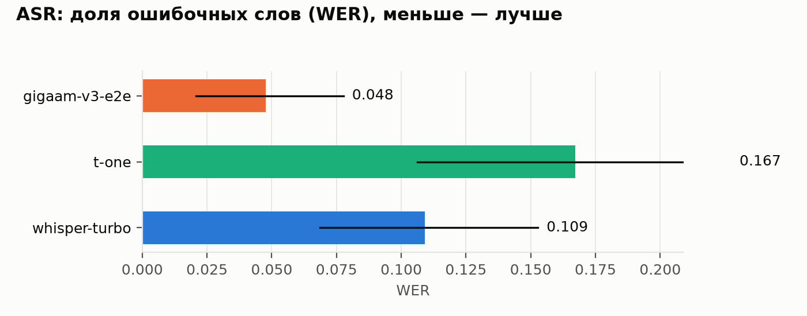
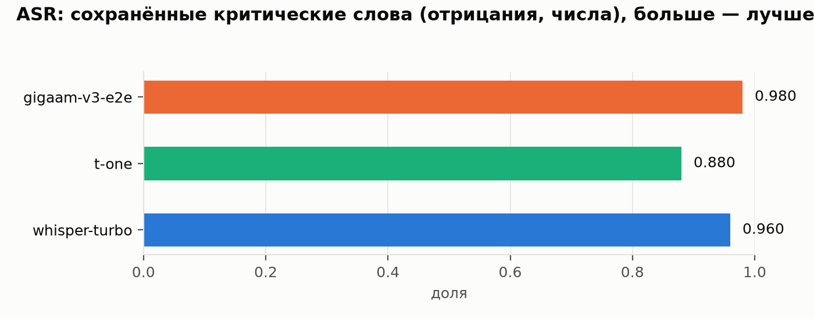
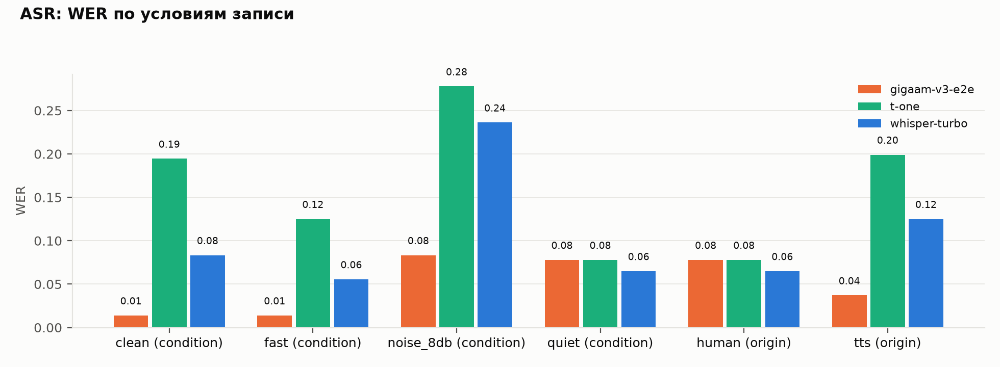
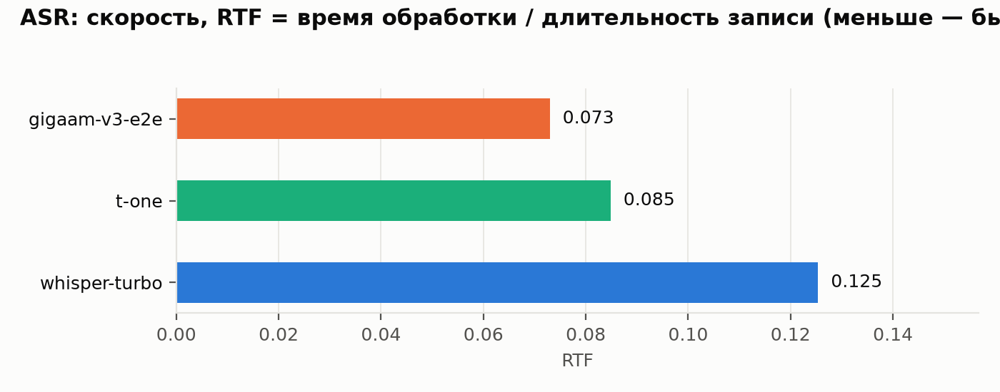

## Извлечение тегов (dev)

Эталонных текстов: 75, утверждено человеком: 75.
Основной срез — `hand` (тексты, написанные вручную). Срез `template` порождён шаблонами и завышает оценки.

### Срез: hand

| Модель | n | macro-F1 | 95% ДИ | micro-F1 | P | R | event-F1 | JSON с 1-й попытки | JSON после повтора | медиана, с | p95, с |
|---|---|---|---|---|---|---|---|---|---|---|---|
| gemma4-e4b | 15 | 1.000 | [1.000; 1.000] | 1.000 | 1.000 | 1.000 | 0.826 | 1.00 | 1.00 | 0.30 | 2.99 |
| qwen3.5-4b | 15 | 0.793 | [0.000; 1.000] | 0.583 | 0.500 | 0.700 | 0.531 | 0.87 | 0.87 | 2.45 | 7.91 |
| qwen3.5-9b | 15 | 0.860 | [0.500; 1.000] | 0.800 | 0.800 | 0.800 | 0.800 | 1.00 | 1.00 | 3.42 | 7.94 |
| rules | 15 | 0.300 | [0.000; 0.667] | 0.333 | 1.000 | 0.200 | 0.278 | 1.00 | 1.00 | 0.00 | 0.00 |

### Срез: challenge

| Модель | n | macro-F1 | 95% ДИ | micro-F1 | P | R | event-F1 | JSON с 1-й попытки | JSON после повтора | медиана, с | p95, с |
|---|---|---|---|---|---|---|---|---|---|---|---|
| gemma4-e4b | 10 | 0.944 | [0.667; 1.000] | 0.923 | 0.857 | 1.000 | 0.769 | 1.00 | 1.00 | 0.74 | 1.13 |
| qwen3.5-4b | 10 | 1.000 | [1.000; 1.000] | 1.000 | 1.000 | 1.000 | 0.800 | 0.90 | 0.90 | 2.38 | 3.83 |
| qwen3.5-9b | 10 | 0.944 | [0.667; 1.000] | 0.923 | 0.857 | 1.000 | 0.917 | 1.00 | 1.00 | 2.77 | 4.87 |
| rules | 10 | 0.611 | [0.250; 1.000] | 0.667 | 0.667 | 0.667 | 0.667 | 1.00 | 1.00 | 0.00 | 0.00 |

### Срез: template

| Модель | n | macro-F1 | 95% ДИ | micro-F1 | P | R | event-F1 | JSON с 1-й попытки | JSON после повтора | медиана, с | p95, с |
|---|---|---|---|---|---|---|---|---|---|---|---|
| gemma4-e4b | 50 | 0.864 | [0.566; 0.944] | 0.857 | 0.750 | 1.000 | 0.780 | 1.00 | 1.00 | 0.55 | 1.52 |
| qwen3.5-4b | 50 | 0.737 | [0.484; 0.831] | 0.762 | 0.667 | 0.889 | 0.672 | 0.98 | 0.98 | 1.45 | 3.65 |
| qwen3.5-9b | 50 | 0.960 | [0.801; 1.000] | 0.947 | 0.900 | 1.000 | 0.862 | 1.00 | 1.00 | 2.76 | 6.89 |
| rules | 50 | 0.988 | [0.900; 1.000] | 0.982 | 0.964 | 1.000 | 0.984 | 1.00 | 1.00 | 0.00 | 0.00 |

### Срез: all

| Модель | n | macro-F1 | 95% ДИ | micro-F1 | P | R | event-F1 | JSON с 1-й попытки | JSON после повтора | медиана, с | p95, с |
|---|---|---|---|---|---|---|---|---|---|---|---|
| gemma4-e4b | 75 | 0.904 | [0.757; 0.959] | 0.896 | 0.811 | 1.000 | 0.790 | 1.00 | 1.00 | 0.56 | 1.65 |
| qwen3.5-4b | 75 | 0.714 | [0.544; 0.790] | 0.747 | 0.661 | 0.860 | 0.653 | 0.95 | 0.95 | 1.50 | 3.93 |
| qwen3.5-9b | 75 | 0.926 | [0.808; 0.977] | 0.911 | 0.872 | 0.953 | 0.854 | 1.00 | 1.00 | 2.79 | 6.88 |
| rules | 75 | 0.867 | [0.681; 0.950] | 0.835 | 0.917 | 0.767 | 0.804 | 1.00 | 1.00 | 0.00 | 0.00 |

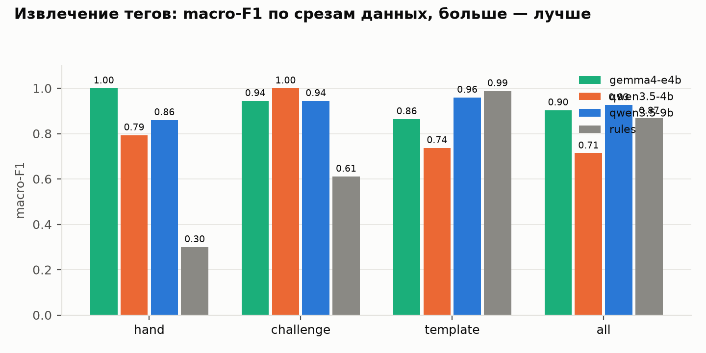
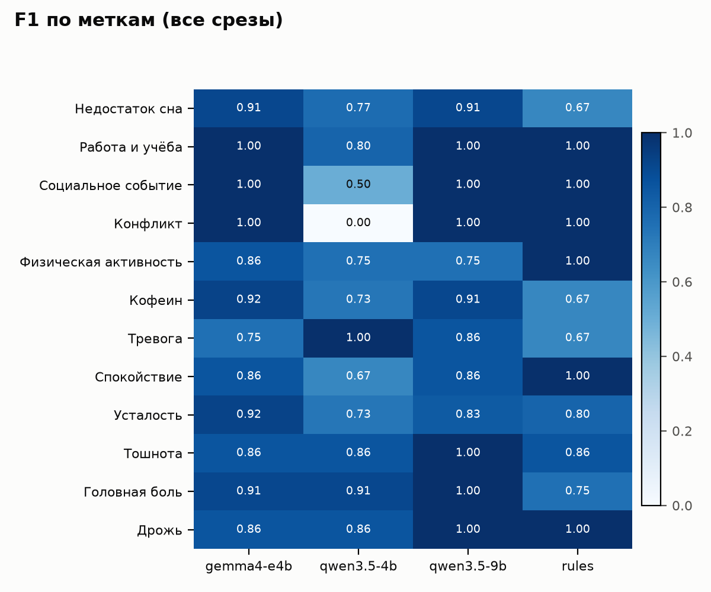
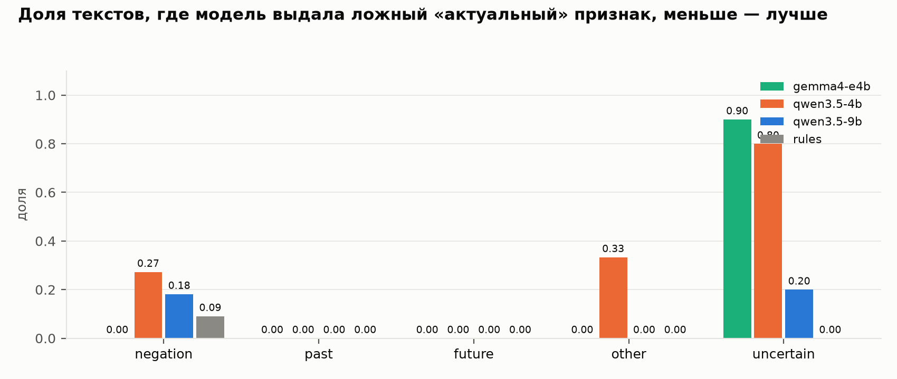
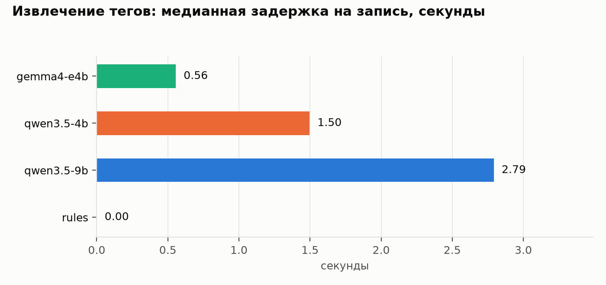

## Обзор для PDF (dev)

Периодов: 10, утверждено человеком: 0. Системы: `template` — шаблон; `<модель>-v1` — модель выбирает и группирует готовые формулировки; `<модель>-free` — модель пишет связный текст, сервер проверяет числа, даты, цитаты и запрещённые обороты. При отказе проверки публикуется шаблон.

| Система | n | Принят с 1-й попытки | Принят после повтора | Откат на шаблон | Охват важных фактов | Охват (только принятые LLM) | Пунктов | Знаков | Медиана, с | Понятность 1–5 | Неподдержанные, доля |
|---|---|---|---|---|---|---|---|---|---|---|---|
| gemma4-e4b-free | 10 | 0.30 | 0.40 | 0.60 | 0.99 | 0.96 | 10.0 | 870 | 9.58 | 3.75 | 0.50 |
| gemma4-e4b-freefb | 10 | 0.30 | 0.50 | 0.50 | 0.97 | 0.94 | 9.2 | 847 | 8.93 | — | — |
| gemma4-e4b-freefbnq | 10 | 0.90 | 0.90 | 0.10 | 0.95 | 0.94 | 4.6 | 606 | 6.07 | — | — |
| gemma4-e4b-freenq | 10 | 0.90 | 0.90 | 0.10 | 0.96 | 0.96 | 5.2 | 619 | 5.15 | 3.89 | 0.11 |
| gemma4-e4b-slots | 10 | 0.40 | 0.40 | 0.60 | 0.93 | 0.82 | 10.3 | 866 | 9.26 | — | — |
| gemma4-e4b-v1 | 10 | 1.00 | 1.00 | 0.00 | 0.96 | 0.96 | 11.6 | 882 | 6.72 | — | — |
| qwen3.5-4b-free | 10 | 0.50 | 0.50 | 0.50 | 0.99 | 0.97 | 9.2 | 789 | 14.31 | — | — |
| qwen3.5-4b-freefb | 10 | 0.50 | 0.50 | 0.50 | 0.99 | 0.97 | 9.2 | 789 | 15.67 | — | — |
| qwen3.5-4b-freefbnq | 10 | 0.60 | 0.60 | 0.40 | 1.00 | 1.00 | 8.1 | 743 | 10.65 | — | — |
| qwen3.5-4b-freenq | 10 | 0.50 | 0.50 | 0.50 | 1.00 | 1.00 | 9.2 | 788 | 9.70 | — | — |
| qwen3.5-4b-slots | 10 | 0.30 | 0.30 | 0.70 | 1.00 | 1.00 | 11.6 | 937 | 19.38 | — | — |
| qwen3.5-4b-v1 | 10 | 0.00 | 0.00 | 1.00 | 1.00 | — | 13.7 | 973 | 31.91 | — | — |
| qwen3.5-9b-free | 10 | 0.20 | 0.20 | 0.80 | 0.97 | 0.88 | 12.7 | 973 | 33.32 | — | — |
| qwen3.5-9b-freefb | 10 | 0.20 | 0.30 | 0.70 | 0.97 | 0.92 | 11.7 | 936 | 38.98 | — | — |
| qwen3.5-9b-freefbnq | 10 | 1.00 | 1.00 | 0.00 | 0.94 | 0.94 | 4.2 | 660 | 23.09 | — | — |
| qwen3.5-9b-freenq | 10 | 0.70 | 0.70 | 0.30 | 1.00 | 1.00 | 7.3 | 762 | 19.66 | 4.14 | 0.14 |
| qwen3.5-9b-slots | 10 | 0.20 | 0.20 | 0.80 | 0.95 | 0.75 | 11.8 | 896 | 28.35 | — | — |
| qwen3.5-9b-v1 | 10 | 0.10 | 0.10 | 0.90 | 0.97 | 0.75 | 13.2 | 963 | 52.20 | — | — |
| template | 10 | 1.00 | 1.00 | 0.00 | 1.00 | 1.00 | 13.7 | 973 | 0.00 | 3.20 | 0.00 |

Причины отклонения первого ответа:

- `gemma4-e4b-free`: CLAIM_CITES_ONLY_QUOTATIONS — 4, UNSUPPORTED_DATE — 1, UNVERIFIED_QUOTATION — 2
- `gemma4-e4b-freefb`: CLAIM_CITES_ONLY_QUOTATIONS — 4, UNSUPPORTED_DATE — 1, UNVERIFIED_QUOTATION — 2
- `gemma4-e4b-freefbnq`: UNVERIFIED_QUOTATION — 1
- `gemma4-e4b-freenq`: UNSUPPORTED_NUMBER — 1
- `gemma4-e4b-slots`: CLAIM_CITES_ONLY_QUOTATIONS — 3, UNKNOWN_FACT — 1, UNVERIFIED_QUOTATION — 2
- `qwen3.5-4b-free`: CLAIM_CITES_ONLY_QUOTATIONS — 1, UNSUPPORTED_DATE — 1, UNSUPPORTED_NUMBER — 3
- `qwen3.5-4b-freefb`: CLAIM_CITES_ONLY_QUOTATIONS — 1, UNSUPPORTED_DATE — 1, UNSUPPORTED_NUMBER — 3
- `qwen3.5-4b-freefbnq`: UNSUPPORTED_NUMBER — 4
- `qwen3.5-4b-freenq`: UNSUPPORTED_DATE — 2, UNSUPPORTED_NUMBER — 3
- `qwen3.5-4b-slots`: SPELLED-OUT_NUMBER — 2, UNKNOWN_FACT — 2, UNSUPPORTED_NUMBER — 3
- `qwen3.5-4b-v1`: UNSUPPORTED_WORDING — 9
- `qwen3.5-9b-free`: CLAIM_CITES_ONLY_QUOTATIONS — 3, UNSUPPORTED_NUMBER — 1, UNVERIFIED_QUOTATION — 4
- `qwen3.5-9b-freefb`: CLAIM_CITES_ONLY_QUOTATIONS — 3, UNSUPPORTED_NUMBER — 1, UNVERIFIED_QUOTATION — 4
- `qwen3.5-9b-freenq`: UNSUPPORTED_DATE — 1, UNSUPPORTED_NUMBER — 2
- `qwen3.5-9b-slots`: CLAIM_CITES_ONLY_QUOTATIONS — 1, FORBIDDEN_WORDING — 1, UNSUPPORTED_NUMBER — 5, UNVERIFIED_QUOTATION — 1
- `qwen3.5-9b-v1`: UNSUPPORTED_WORDING — 9

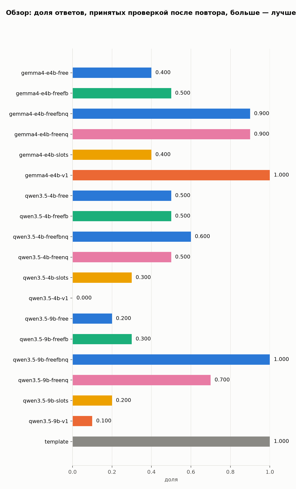
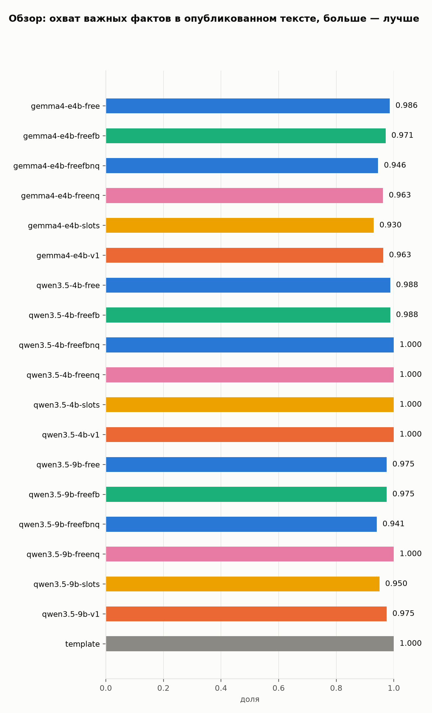
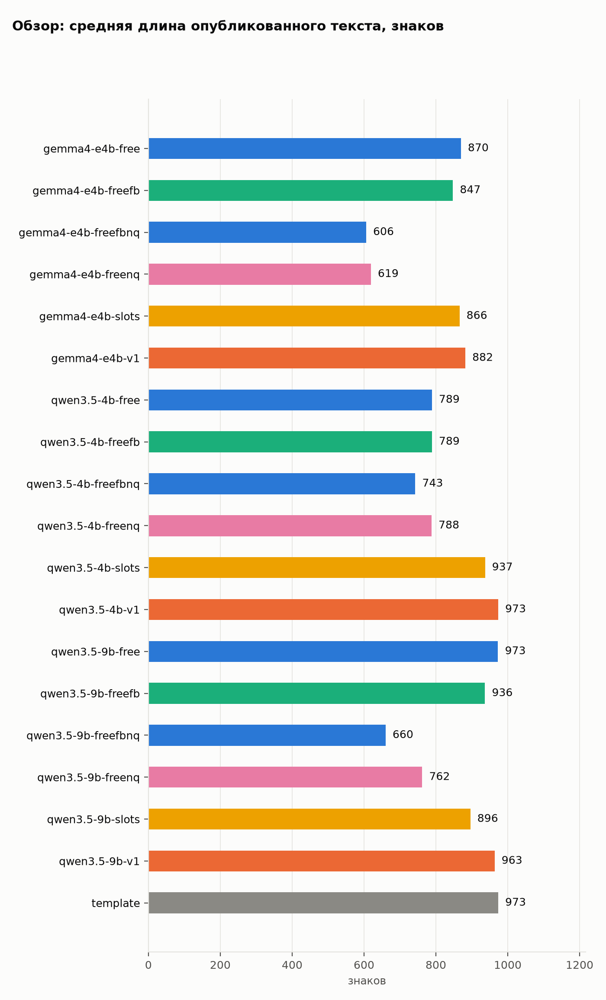

## ASR (test)

Эталонных записей: 100, утверждено человеком: 100.

| Модель | n | Сбоев | WER | 95% ДИ WER | CER | Критические слова | Тишина: ложный текст | Знаки препинания | RTF (медиана) | RTF (p95) |
|---|---|---|---|---|---|---|---|---|---|---|
| gigaam-v3-e2e | 97 | 0 | 0.060 | [0.041; 0.081] | 0.036 | 1.000 | 0/3 | 1.00 | 0.063 | 0.091 |
| whisper-turbo | 97 | 0 | 0.038 | [0.024; 0.053] | 0.023 | 0.986 | 3/3 | 1.00 | 0.084 | 0.113 |

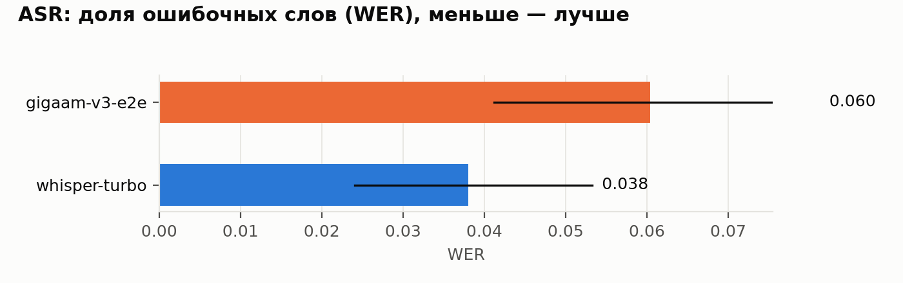
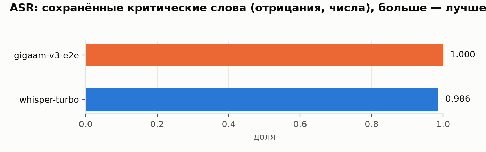
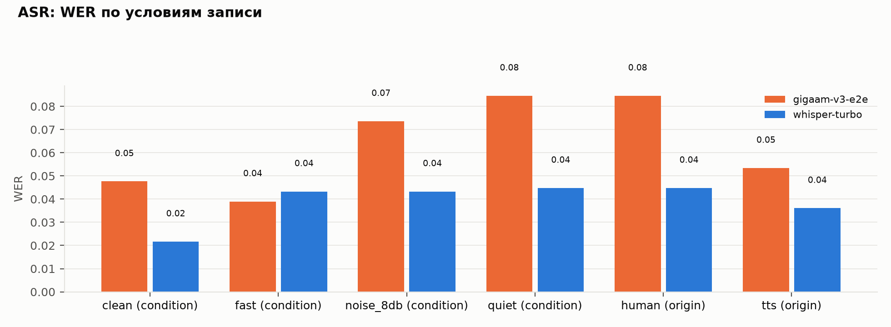
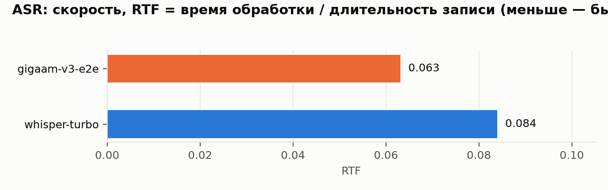

## Извлечение тегов (test)

Эталонных текстов: 189, утверждено человеком: 189.
Основной срез — `hand` (тексты, написанные вручную). Срез `template` порождён шаблонами и завышает оценки.

### Срез: hand

| Модель | n | macro-F1 | 95% ДИ | micro-F1 | P | R | event-F1 | JSON с 1-й попытки | JSON после повтора | медиана, с | p95, с |
|---|---|---|---|---|---|---|---|---|---|---|---|
| gemma4-e4b | 39 | 0.728 | [0.621; 0.812] | 0.806 | 0.871 | 0.750 | 0.750 | 1.00 | 1.00 | 0.61 | 2.09 |
| qwen3.5-9b | 39 | 0.767 | [0.586; 0.872] | 0.806 | 0.871 | 0.750 | 0.759 | 0.95 | 0.95 | 2.99 | 8.93 |
| rules | 39 | 0.337 | [0.112; 0.566] | 0.431 | 0.733 | 0.306 | 0.340 | 1.00 | 1.00 | 0.00 | 0.00 |

### Срез: template

| Модель | n | macro-F1 | 95% ДИ | micro-F1 | P | R | event-F1 | JSON с 1-й попытки | JSON после повтора | медиана, с | p95, с |
|---|---|---|---|---|---|---|---|---|---|---|---|
| gemma4-e4b | 150 | 0.998 | [0.993; 1.000] | 0.998 | 1.000 | 0.996 | 0.982 | 1.00 | 1.00 | 1.41 | 1.50 |
| qwen3.5-9b | 150 | 0.970 | [0.953; 0.984] | 0.969 | 0.941 | 1.000 | 0.938 | 1.00 | 1.00 | 6.26 | 6.70 |
| rules | 150 | 0.946 | [0.907; 0.977] | 0.946 | 0.996 | 0.900 | 0.911 | 1.00 | 1.00 | 0.00 | 0.00 |

### Срез: all

| Модель | n | macro-F1 | 95% ДИ | micro-F1 | P | R | event-F1 | JSON с 1-й попытки | JSON после повтора | медиана, с | p95, с |
|---|---|---|---|---|---|---|---|---|---|---|---|
| gemma4-e4b | 189 | 0.977 | [0.960; 0.990] | 0.977 | 0.987 | 0.967 | 0.945 | 1.00 | 1.00 | 1.36 | 1.51 |
| qwen3.5-9b | 189 | 0.952 | [0.929; 0.969] | 0.952 | 0.934 | 0.971 | 0.910 | 0.99 | 0.99 | 4.84 | 6.79 |
| rules | 189 | 0.900 | [0.848; 0.940] | 0.899 | 0.981 | 0.830 | 0.833 | 1.00 | 1.00 | 0.00 | 0.00 |

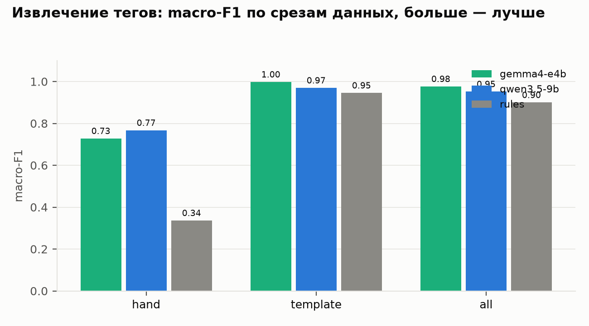
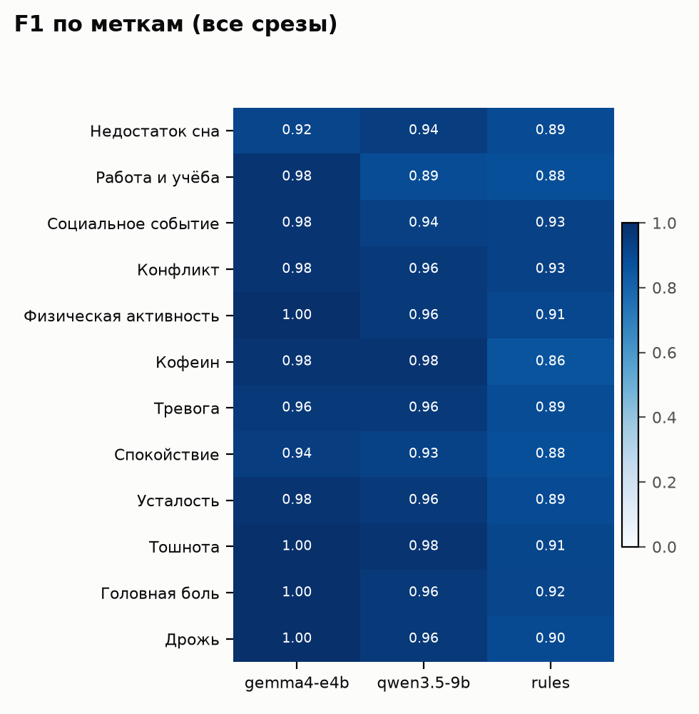
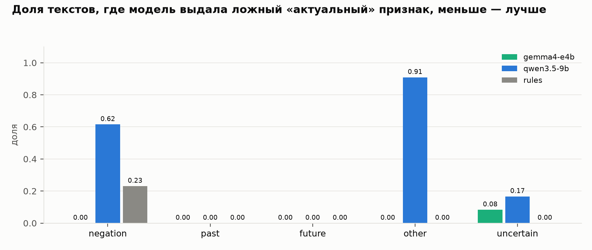
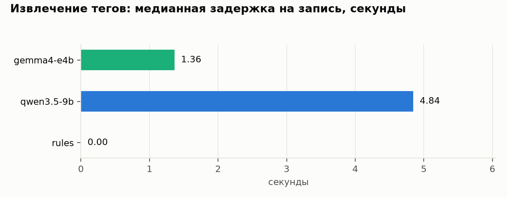

## Обзор для PDF (test)

Периодов: 25, утверждено человеком: 25. Системы: `template` — шаблон; `<модель>-v1` — модель выбирает и группирует готовые формулировки; `<модель>-free` — модель пишет связный текст, сервер проверяет числа, даты, цитаты и запрещённые обороты. При отказе проверки публикуется шаблон.

| Система | n | Принят с 1-й попытки | Принят после повтора | Откат на шаблон | Охват важных фактов | Охват (только принятые LLM) | Пунктов | Знаков | Медиана, с | Понятность 1–5 | Неподдержанные, доля |
|---|---|---|---|---|---|---|---|---|---|---|---|
| gemma4-e4b-free | 25 | 0.88 | 0.96 | 0.04 | 0.93 | 0.93 | 5.0 | 675 | 4.91 | 3.46 | 0.38 |
| gemma4-e4b-freenq | 25 | 0.96 | 0.96 | 0.04 | 0.95 | 0.95 | 4.9 | 626 | 4.52 | 3.79 | 0.29 |
| qwen3.5-9b-free | 25 | 0.48 | 0.48 | 0.52 | 0.98 | 0.96 | 9.8 | 874 | 20.41 | 3.33 | 0.67 |
| qwen3.5-9b-freenq | 25 | 0.72 | 0.72 | 0.28 | 0.98 | 0.98 | 7.1 | 770 | 17.24 | 3.67 | 0.44 |
| template | 25 | 1.00 | 1.00 | 0.00 | 1.00 | 1.00 | 13.8 | 990 | 0.00 | 3.00 | 0.00 |

Причины отклонения первого ответа:

- `gemma4-e4b-free`: CLAIM_CITES_ONLY_QUOTATIONS — 2, UNSUPPORTED_NUMBER — 1
- `gemma4-e4b-freenq`: FORBIDDEN_WORDING — 1
- `qwen3.5-9b-free`: CLAIM_CITES_ONLY_QUOTATIONS — 3, FORBIDDEN_WORDING — 1, SPELLED-OUT_NUMBER — 1, UNSUPPORTED_DATE — 2, UNSUPPORTED_NUMBER — 4, UNVERIFIED_QUOTATION — 2
- `qwen3.5-9b-freenq`: SPELLED-OUT_NUMBER — 3, UNSUPPORTED_NUMBER — 4

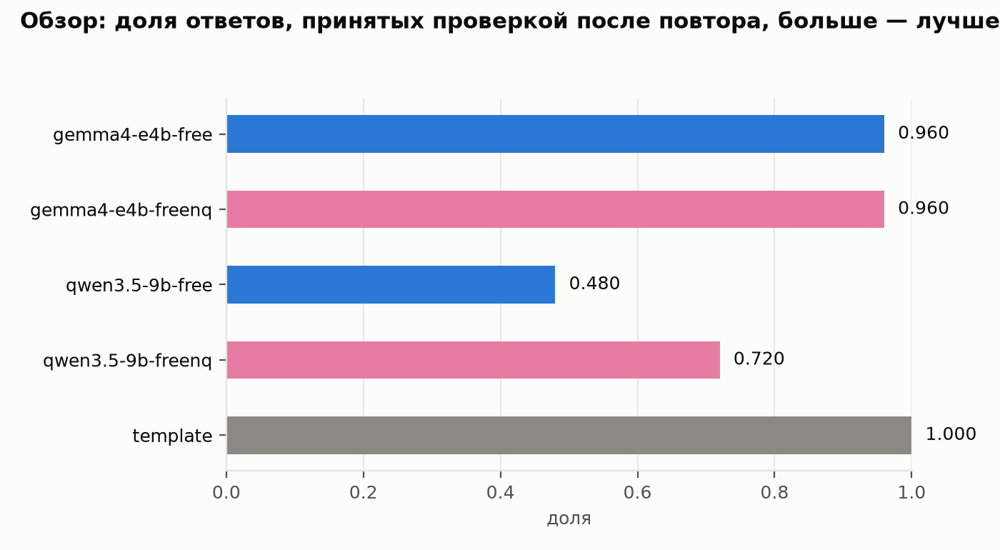
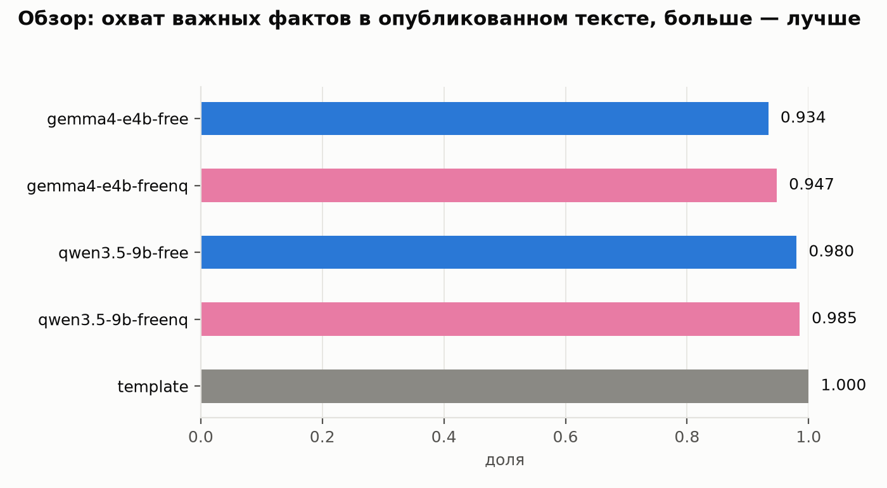
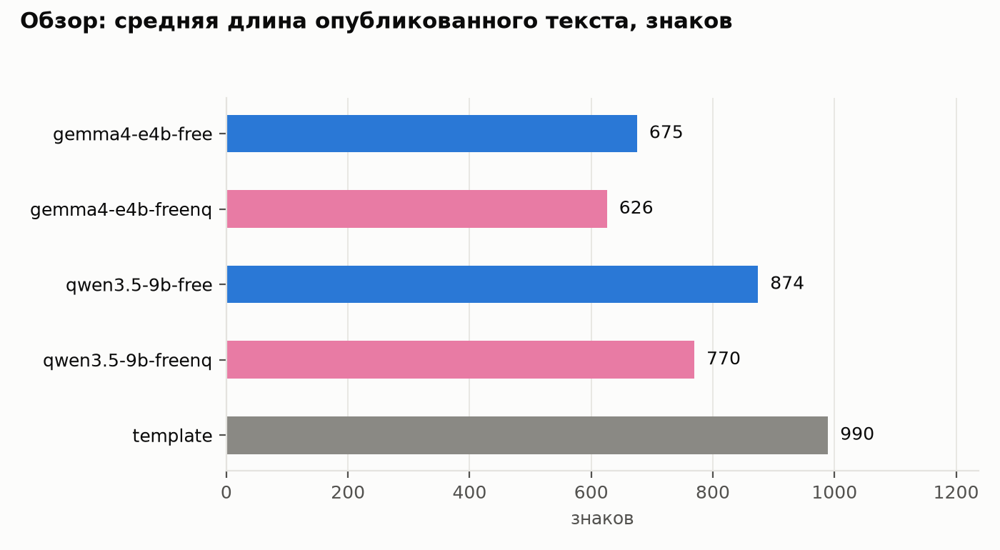

